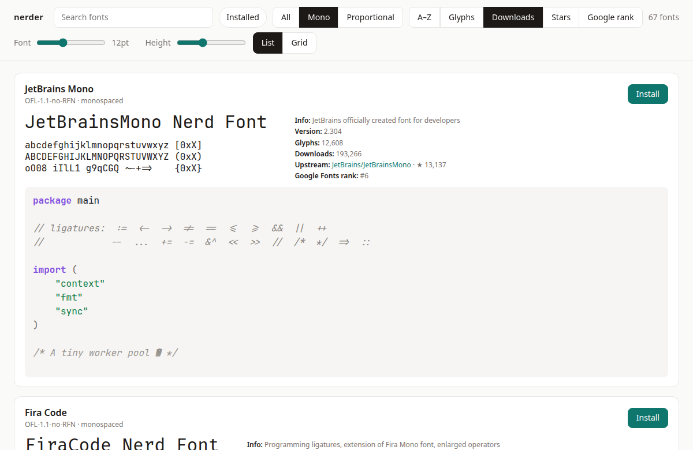
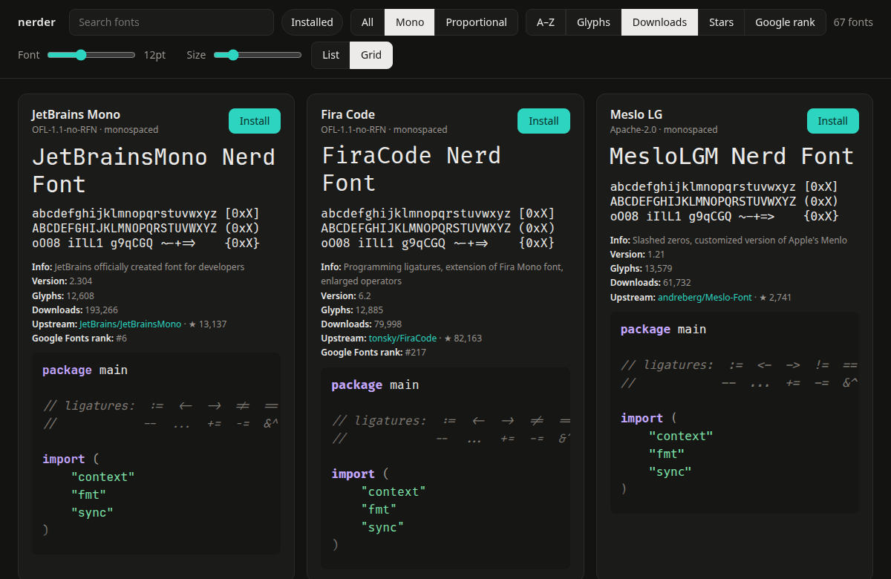

# nerder

Browse every [Nerd Fonts](https://www.nerdfonts.com) family rendered in its real
font on a syntax-coloured Go snippet, then install or uninstall it with one
click. Some terminals and editors still need a restart to pick up a new font.

| | Fonts go to | Made available by |
|---|---|---|
| Linux | `~/.local/share/fonts/NerdFonts/<Family>/` (or `$XDG_DATA_HOME/fonts`) | running `fc-cache` |
| macOS | `~/Library/Fonts/NerdFonts/<Family>/` | nothing; macOS picks them up |

Linux (amd64, arm64) and macOS (Intel and Apple Silicon, 13 or newer). Built with
Go and [Wails](https://wails.io) v2 (WebKitGTK on Linux, WKWebView on macOS).

<p>
  
  
</p>

## Features

- **Every Nerd Fonts family, in its real font.** All 72 families (release v3.5.1)
  are rendered on a syntax-coloured Go sample that exercises most of the language,
  with a ligature line and Nerd Font glyphs. Fonts download on demand, when a card
  scrolls into view, and are cached on disk.
- **One-click install and uninstall.** Installs go to the user fonts folder and the
  font is made available immediately; an *Installed* badge marks what you have, and
  fonts installed some other way (including system ones) are detected.
- **A specimen block like nerdfonts.com's.** The font's title and sample characters
  set in the font, plus its description, version and the original or reserved font name.
- **More facts per font.** Glyph count, release downloads, the upstream project's link
  and GitHub stars, and the Google Fonts popularity rank where Google hosts the font.
- **Find fonts fast.** Fuzzy search, an installed-only filter and an
  All / Mono / Proportional filter (Mono by default).
- **Sort by** A–Z, glyph count, downloads, upstream stars or Google Fonts rank.
- **List and Grid layouts.** List previews flow into text columns to use wide windows.
  Sliders set the code font size (in points, as terminals and editors do), the grid
  card width and the list preview height.
- **Remembers your setup.** Layout, sizes, and the window's size, position and
  maximised state come back on the next launch. Light and dark follow the system.
- **Linux and macOS.** Linux amd64 and arm64, macOS on Intel and Apple Silicon, built
  by GitHub Actions. Popularity numbers are a snapshot embedded in the app and
  refreshed with `just snapshot`.

## Using it

```
just build        # compile in the container -> build/bin/nerder
./build/bin/nerder
```

On Linux the binary needs only the WebKitGTK runtime library
(`libwebkit2gtk-4.1-0` on Debian/Ubuntu); on macOS, `just build` makes a universal
`build/bin/nerder.app` and needs Go, Node and the Xcode command line tools. Families are downloaded the first
time their card scrolls into view and cached under `~/.cache/nerder/`.

## Builds and releases

GitHub Actions (`.github/workflows/ci.yml`) runs the tests on Linux and macOS,
then builds `linux-amd64`, `linux-arm64` and a universal `macos-universal` app on
native runners and uploads them as workflow artifacts. Pushing a tag such as
`v0.1.0` also publishes them as a GitHub release. The macOS app is not signed or
notarized, so Gatekeeper asks you to right-click and choose Open the first time
(or run `xattr -dr com.apple.quarantine nerder.app`). The `ubuntu-24.04-arm`
runner is free for public repositories only.

## Developing

Compiling happens in a container, so the host needs no GTK or WebKitGTK
development packages. You need [Podman](https://podman.io) and
[just](https://github.com/casey/just).

```
just image          # build the container image (once)
just build          # wails build in the container
just test           # go test ./... in the container
just test-internal  # pure-Go packages only, on the host
just dev            # live-reloading UI at http://localhost:34115
just shell          # shell inside the build container
just desktop-install   # build, then install binary (~/.local/bin), icon and desktop entry (~/.local/share)
just desktop-uninstall # remove them again
just snapshot       # regenerate glyph counts, downloads, stars, Google Fonts rank (needs network)
```

`just dev` runs `wails dev` under Xvfb in the container; open
http://localhost:34115 in a browser. Installs made there go to the container's
throwaway home (`~/.cache/nerder-build/home`), not your real fonts folder.

Archive availability can be checked against GitHub with
`go test -tags live ./internal/fetch/ -run Live`.

## Layout

- `internal/catalog` embedded font list, fuzzy search, file-to-family matching
- `internal/snippet` the Go sample and its highlighter
- `internal/fetch` download, extract and cache font archives
- `internal/installer` install, uninstall, installed-state detection
- `internal/app` the methods bound to the front end, plus the font file handler
- `frontend/` plain JS/CSS UI

## Updating the Nerd Fonts version

Replace `internal/catalog/fonts.json` with the file from the new release tag,
change `ReleaseTag` in `internal/catalog/catalog.go`, and update the expected
family count in the catalog tests.
Then run `just snapshot` to refresh `internal/catalog/stats.json`: glyph counts,
release-archive downloads, the GitHub stars of each upstream
project and the Google Fonts popularity rank. These are embedded in the binary, so
the numbers are as of the last snapshot. Which repo belongs to which font is in
`internal/catalog/upstream.json`; fonts without a clean upstream repo show no stars.
